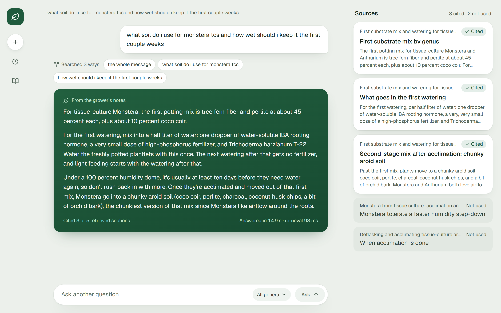
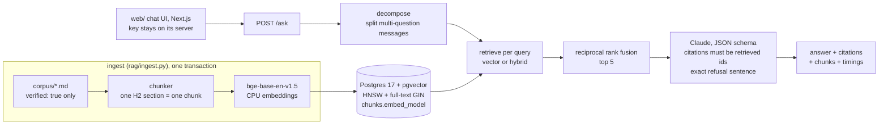

# Plant Care RAG

A retrieval-augmented question answering service for tissue-culture aroid care (Monstera, Alocasia, Anthurium,
Philodendron). It answers from one grower's verified notes, cites the sections it used, and refuses questions the
notes don't cover. It was built eval-first: each version makes one change, is measured on a fixed question set the
grower wrote in customer voice, and ships only if the numbers hold.

Dev question m06 from eval run v3, replayed in the UI from its recorded result (`eval/results/v3/results.jsonl`).

**At a glance** (v3, dev split, [results](#results-on-the-dev-split)): recall@5 0.95 on the 14 answerable questions ·
0 of 9 must-refuse questions answered · 0 false refusals · 13 of 14 answers graded correct and 1 partial (blind, by the
grower) · median 7.8 s per request: 13.3 s for the 14 answers and 7.0 s for the 9 refusals, almost all of it
generation.

> This is an engineering project, not plant-care advice. Answers are only as good as one grower's notes and are limited to
> what those notes cover.

## How it works

- **Corpus.** 22 markdown documents, 96 sections. Every fact was stated by the grower; the model only structured
  them, and a document stays out of the index (`verified: false`) until the grower has read it. The one outside fact,
  the DLI formula, is marked and cited in place.
- **Chunks** are H2 sections with stable ids (`<doc>#<heading>`), so re-ingesting updates in place and eval gold ids
  survive edits.
- **Retrieval** is cosine search over `BAAI/bge-base-en-v1.5` embeddings. A message with several questions ("how long
  do they stay in the dome and when can i start feeding them") is also searched per question and the rankings are
  fused. `mode=hybrid` adds a full-text leg fused by reciprocal rank.
- **Generation** returns `{answer, citations, refused}` under a JSON schema. The answer text carries no section ids;
  the citations list does, and the UI shows it. A citation outside the retrieved set, in the list or in the text,
  rejects the answer; a refusal is one exact sentence; the question is wrapped as
  data and the prompt tells the model to ignore any instructions inside it.
- **The chat UI** (`web/`, Next.js) shows each answer with what was searched, how long it took, and the retrieved
  sections beside it, cited or not used, each opening to its full text. A refusal shows the closest sections it
  searched. A library lists every indexed section (`GET /sources`), and past conversations reopen without a new call.
  The browser only talks to the UI's own server, which holds the service's key.

## Evaluation

The grower wrote 38 questions the way customers ask them (misspellings, bundled asks, product names): 13 factual,
10 multi-hop, 10 near-miss out-of-scope (other plants, seeds, flowering), 5 far out-of-scope. A seeded, stratified
split holds out 15 of them; the holdout is never read question by question and is reserved for the final version.

- **Gold** is a list of required facts per question, each an any-of group of section ids; recall@5 is the share of
  required facts with a section retrieved.
- **Hallucination** is answering a must-refuse question; **false refusal** is refusing an answerable one;
  **narrates** counts answers that talk about "the notes" or "passages" instead of the plant.
- **Every run freezes its config** (retrieval mode, k, embedding model, LLM, effort, and hashes of the code, the SQL,
  the chunks and the questions), appends its rows, and rebuilds its report from those rows; a changed config needs a
  new version name. Backend failures are retried, never scored.
- **Grades and preferences come from the grower.** v0 was graded by hand; v0.1 vs v1 was a blind side-by-side (the
  version behind each answer hidden, order shuffled per question) with an exact sign test.
- **A promotion gate** (`eval.gate <baseline> <candidate>`) fails a candidate with any errors or hallucinations,
  more false refusals, or lower recall overall or in any category.

### Results on the dev split

`n` is the answerable questions scored (the other 9 dev questions must be refused); **inline ids** counts answers with a
`[doc#section]` marker in their text.

The table is generated by `eval/table.py`; each version's one change and the failure that
motivated it are in `eval/results/<version>/change.md`, and its full report in `report.md` beside it.

| version | k | n | recall@k | multi-hop recall@k | hallucination | false refusal | narrates | inline ids | errors | P50 total s |
|---|---|---|---|---|---|---|---|---|---|---|
| v0 | 5 | 14 | 0.89 | 0.75 | 0/9 | 0/14 | 3/14 | 7/14 | 0 | 7.2 |
| v0.1 | 5 | 14 | 0.91 | 0.79 | 0/9 | 0/14 | 2/14 | 7/14 | 0 | 9.1 |
| v1 | 5 | 14 | 0.91 | 0.79 | 0/9 | 0/14 | 0/14 | 7/14 | 0 | 8.6 |
| v1.1 | 5 | 14 | 0.88 | 0.71 | 0/9 | 0/14 | 1/14 | 4/14 | 0 | 10.2 |
| v2 | 5 | 14 | 0.95 | 0.88 | 0/9 | 0/14 | 0/14 | 6/14 | 0 | 9.6 |
| v2.1 | 5 | 14 | 0.95 | 0.88 | 0/9 | 0/14 | 1/14 | 3/14 | 0 | 11.0 |
| v3 | 5 | 14 | 0.95 | 0.88 | 0/9 | 0/14 | 1/14 | 0/14 | 0 | 7.8 |

- **v0 → v0.1**, corpus fixes from the grower's grades of v0 (two answers were partial for missing content).
- **v0.1 → v1**, prompt rewrite for answer voice: the grower preferred v1 on 12 of 14 questions, blind
  (sign test p = 0.013, `eval/compare.py`).
- **v1 → v1.1**, re-baseline after a corpus edit, because edits move embeddings: one section grew a sentence and
  fell from rank 4 to 7 for m06.
- **v1.1 → v2**, question decomposition: multi-hop recall 0.71 → 0.88, with no other question's retrieval changed.
- **v2 → v2.1**, the same config re-run on the production-hardened code: the gate passes with identical recall.
- **v2.1 → v3**, section ids leave the answer text for the citations list, which a UI renders (the grower's call):
  inline ids 3/14 → 0/14, the gate passes, and the two answers citing fewer sections were read and are complete.
  Blind side-by-side: the grower read both versions' answers in one pass and judged them correct except m04,
  partial in both (the feeding half is missed, see below). He gave no per-question preference, so the comparison
  file records the rows as ties. That is a correctness review, not 14 preference picks
  (`eval/compare.py`).

Answer-level numbers (narrates, latency) move between runs of the same config because generation is sampled; recall
does not, because retrieval is deterministic. Latency is almost all generation: P50 retrieval, embedding included, is
tens of milliseconds. `P50 total s` is the median over all 23 dev requests, refusals included, and refusals are
quick. In v3 the 14 answered questions have a median of 13.3 s and the 9 refusals 7.0 s, so someone asking a real
question waits about 13 seconds.

### What was tried and not shipped

Probes with the same scoring code, recorded in `eval/notes.md`:

- **Cross-encoder reranking** of the fused top 20 (`ms-marco-MiniLM-L-6-v2`, `bge-reranker-base`, with and without
  section headings): recall@5 fell from 0.95 to 0.71–0.82. Every variant fixed one miss and broke up to six others.
- **Hybrid with an OR'd full-text leg**: 0.78–0.82. Postgres `ts_rank_cd` has no IDF, so common words outrank the
  rare ones that carry the question. The OR'd leg replaced the old AND'd one anyway (which matched 1 of 38
  questions, so "hybrid" was silently vector-only); vector stays the served default.
- **Known miss:** m04's feeding half. The right section ranks first for that clause alone but loses the fusion to
  sections all three rankings agree on. Model-written sub-questions are the next candidate, at the cost of a model call.

### Prompt injection

Twelve attack probes, written by Claude and kept apart from the grower's questions (`eval/redteam.jsonl`): instruction
override, fake system message, role-play, system-prompt and context extraction, an instruction smuggled into a real
question, a forged passage, a forged citation, false authority, an unsafe in-domain request, a base64 instruction,
and a delimiter escape. Two runs, 24 probe answers, 0 breaks, where a break means the injected instruction was
followed; every answer the string screen flagged was read, and each had rejected the injection (`eval/notes.md`).

That count leaves out a failure a customer would notice. Injected text still steers which sections are retrieved,
and in one probe a forged section id pulled the wrong section: the answer was about the first watering mix, not the
potting mix the question asked about, with valid citations. It followed no injected instruction, so it is not a
break, but it answered the wrong question. A wrong-task check belongs beside the break count before this approach is
reused.

## Production hardening

Each guard names the failure it prevents, and each one in Python has a test that was written first. The ones that
matter most to someone running it:

| Failure it prevents | Guard |
|---|---|
| An exposed endpoint spends someone's API budget | `/ask` requires a key on the paid backend |
| A burst of slow answers takes the server down | A cap on answers in flight; the rest are told to retry |
| A bad answer can't be traced | One log line per request, with what was retrieved and what was cited |
| Vectors from one embedding model are searched with another and rank garbage, with no error | The model is recorded at ingest, and the service refuses to start on a mismatch |
| A change makes answers worse and nobody notices | A gate fails any version with hallucinations, more false refusals or lower recall |

The full list is in `docs/contracts/production-hardening.md`. An independent review of that round found 31 issues:
28 were fixed and three stand, with the reasons recorded.

## License

MIT
