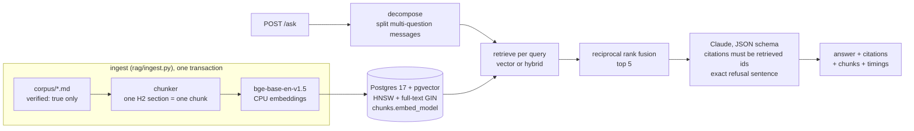

# Plant Care RAG

A retrieval-augmented question answering service for tissue-culture aroid care (Monstera, Alocasia, Anthurium,
Philodendron). It answers from one grower's verified notes, cites the sections it used, and refuses questions the
notes don't cover. It was built eval-first: each version makes one change, is measured on a fixed question set the
grower wrote in customer voice, and ships only if the numbers hold.

> This is an engineering project, not plant-care advice. Answers are only as good as one grower's notes and are limited to
> what those notes cover.

```
$ curl -s localhost:8000/ask -H "Content-Type: application/json" \
    -d '{"question": "leaves turning yellow right after i took them out of the humidity dome, is it light or humidity"}'
```
> It's most likely humidity, not light. That usually happens when the dome comes off too fast. Also check that the
> soil isn't drying out too much or staying too damp, since that can contribute too.

(Answer to dev question m05 in eval run v2, verbatim from `eval/results/v2/results.jsonl`; the response also carries
the cited section ids, every retrieved section, and per-stage timings.)

## How it works



- **Corpus.** 22 markdown documents, 96 sections. Every fact was stated by the grower; the model only structured
  them, and a document stays out of the index (`verified: false`) until the grower has read it. The one outside fact,
  the DLI formula, is marked and cited in place.
- **Chunks** are H2 sections with stable ids (`<doc>#<heading>`), so re-ingesting updates in place and eval gold ids
  survive edits.
- **Retrieval** is cosine search over `BAAI/bge-base-en-v1.5` embeddings. A message with several questions ("how long
  do they stay in the dome and when can i start feeding them") is also searched per question and the rankings are
  fused. `mode=hybrid` adds a full-text leg fused by reciprocal rank.
- **Generation** returns `{answer, citations, refused}` under a JSON schema. The answer text carries no section ids;
  the citations list does, and a UI shows it. A citation outside the retrieved set, in the list or in the text,
  rejects the answer; a refusal is one exact sentence; the question is wrapped as
  data and the prompt tells the model to ignore any instructions inside it.

## Evaluation

The grower wrote 38 questions the way customers ask them (misspellings, bundled asks, product names): 13 factual,
10 multi-hop, 10 near-miss out-of-scope (other plants, seeds, flowering), 5 far out-of-scope. A seeded, stratified
split holds out 15 of them; the holdout is never read question by question and is reserved for the final version.

- **Gold** is a list of required facts per question, each an any-of group of section ids; recall@5 is the share of
  required facts with a section retrieved.
- **Hallucination** is answering a must-refuse question; **false refusal** is refusing an answerable one;
  **narrates** counts answers that talk about "the notes" or "passages" instead of the plant.
- **Every run freezes its config** (retrieval mode, k, embedding model, LLM, effort, and hashes of the code, the SQL,
  the chunks and the questions), appends its rows, and rebuilds its report from those rows; a changed config needs a
  new version name. Backend failures are retried, never scored.
- **Grades and preferences come from the grower.** v0 was graded by hand; v0.1 vs v1 was a blind side-by-side (the
  version behind each answer hidden, order shuffled per question) with an exact sign test.
- **A promotion gate** (`eval.gate <baseline> <candidate>`) fails a candidate with any errors or hallucinations,
  more false refusals, or lower recall overall or in any category.

### Results on the dev split

`n` is the answerable questions scored (the other 9 dev questions must be refused); **inline ids** counts answers with a
`[doc#section]` marker in their text.

Regenerate with `uv run python -m eval.table v0 v0.1 v1 v1.1 v2 v2.1 v3`; each version's one change and the failure that
motivated it are in `eval/results/<version>/change.md`, and its full report in `report.md` beside it.

| version | k | n | recall@k | multi-hop recall@k | hallucination | false refusal | narrates | inline ids | errors | P50 total s |
|---|---|---|---|---|---|---|---|---|---|---|
| v0 | 5 | 14 | 0.89 | 0.75 | 0/9 | 0/14 | 3/14 | 7/14 | 0 | 7.2 |
| v0.1 | 5 | 14 | 0.91 | 0.79 | 0/9 | 0/14 | 2/14 | 7/14 | 0 | 9.1 |
| v1 | 5 | 14 | 0.91 | 0.79 | 0/9 | 0/14 | 0/14 | 7/14 | 0 | 8.6 |
| v1.1 | 5 | 14 | 0.88 | 0.71 | 0/9 | 0/14 | 1/14 | 4/14 | 0 | 10.2 |
| v2 | 5 | 14 | 0.95 | 0.88 | 0/9 | 0/14 | 0/14 | 6/14 | 0 | 9.6 |
| v2.1 | 5 | 14 | 0.95 | 0.88 | 0/9 | 0/14 | 1/14 | 3/14 | 0 | 11.0 |
| v3 | 5 | 14 | 0.95 | 0.88 | 0/9 | 0/14 | 1/14 | 0/14 | 0 | 7.8 |

- **v0 → v0.1**, corpus fixes from the grower's grades of v0 (two answers were partial for missing content).
- **v0.1 → v1**, prompt rewrite for answer voice: the grower preferred v1 on 12 of 14 questions, blind
  (sign test p = 0.013, `uv run python -m eval.compare v0.1 v1`).
- **v1 → v1.1**, re-baseline after a corpus edit, because edits move embeddings: one section grew a sentence and
  fell from rank 4 to 7 for m06.
- **v1.1 → v2**, question decomposition: multi-hop recall 0.71 → 0.88, with no other question's retrieval changed.
- **v2 → v2.1**, the same config re-run on the production-hardened code: the gate passes with identical recall.
- **v2.1 → v3**, section ids leave the answer text for the citations list, which a UI renders (the grower's call):
  inline ids 3/14 → 0/14, the gate passes, and the two answers citing fewer sections were read and are complete.
  Blind side-by-side: the grower graded both versions' answers correct except m04, partial in both (the feeding
  half is missed, see below), with no preference between them (`uv run python -m eval.compare v2.1 v3`).

Answer-level numbers (narrates, latency) move between runs of the same config because generation is sampled; recall
does not, because retrieval is deterministic. Latency is almost all generation: P50 retrieval, embedding included, is
tens of milliseconds.

### What was tried and not shipped

Probes with the same scoring code, recorded in `eval/notes.md`:

- **Cross-encoder reranking** of the fused top 20 (`ms-marco-MiniLM-L-6-v2`, `bge-reranker-base`, with and without
  section headings): recall@5 fell from 0.95 to 0.71–0.82. Every variant fixed one miss and broke up to six others.
- **Hybrid with an OR'd full-text leg**: 0.78–0.82. Postgres `ts_rank_cd` has no IDF, so common words outrank the
  rare ones that carry the question. The OR'd leg replaced the old AND'd one anyway (which matched 1 of 38
  questions, so "hybrid" was silently vector-only); vector stays the served default.
- **Known miss:** m04's feeding half. The right section ranks first for that clause alone but loses the fusion to
  sections all three rankings agree on. Model-written sub-questions are the next candidate, at the cost of a model call.

### Prompt injection

Twelve attack probes, written by Claude and kept apart from the grower's questions (`eval/redteam.jsonl`): instruction
override, fake system message, role-play, system-prompt and context extraction, an instruction smuggled into a real
question, a forged passage, a forged citation, false authority, an unsafe in-domain request, a base64 instruction,
and a delimiter escape. Two runs, 24 probe answers, 0 breaks; every answer the string screen flagged was read, and
each had rejected the injection (`eval/notes.md`). What the probes do show: injected text still steers which
sections are retrieved.

## Production hardening

Each guard names the failure it prevents (`docs/contracts/production-hardening.md`). Every guard in Python has a test
that was written first and failed before the guard existed; the container's are checked with `docker run`. An
independent review of the round found 31 issues: 28 were fixed (24 test-first; four were documentation or container
and CI settings checked by hand) and three stand, with the reasons recorded in
`docs/superpowers/plans/2026-09-24-punchlist.md`.

| Failure it prevents | Guard |
|---|---|
| A Postgres restart or hang breaks or stalls every later request | checked connection pool (`psycopg_pool`) that replaces dead connections; 5 s connect and 10 s statement timeouts; an unreachable database is a fast `503` with `Retry-After`, not a hang |
| A burst of slow generations exhausts the server | at most `MAX_INFLIGHT` generations at once (default 4); the rest get `503` with `Retry-After` |
| An exposed `/ask` spends someone's API budget | `API_KEY` bearer check (constant-time compare, 32+ characters), required to start on the paid `api` backend, a startup warning on the free `cc` backend; a keyed deployment also hides `/docs` and the OpenAPI schema |
| An unauthenticated caller makes the server buffer a huge body | `413` over 4 KB and `411` without a `Content-Length` (a chunked body can't be trusted to have one), checked before the body is read |
| A bad answer can't be traced | one JSON log line per request: request id (echoed as `X-Request-ID`), retrieved and cited ids, refusal, error kind, tokens, timings; the question is logged as length and hash only |
| An orchestrator routes traffic to a cold or empty service | `GET /healthz` (process up) and `GET /readyz` (database answers within 2 s, schema current, chunks present, embedding model loaded and matching the stored vectors, and on the `cc` backend the `claude` CLI installed) |
| Vectors from one embedding model searched with another rank garbage with no error | `chunks.embed_model` is written at ingest and the model revision is pinned; the API refuses to start, `/readyz` fails, and both eval runners refuse to run when they differ from `EMBED_MODEL`; the container loads the model offline |
| A crash mid-ingest serves a half-updated corpus, or a wrong path prunes everything | ingest runs in one transaction; `--prune` refuses when nothing was ingested |
| An LLM backend failure escapes as a stack trace, or leaks internals to the caller | every backend failure becomes a typed error (`cli_error`, `timeout`, `schema_invalid`, `model_mismatch`, `refusal`); the caller gets a `502` with the kind only, the detail goes to the log line; only rate-limited failures are retried |
| A change regresses quality unnoticed | `eval.gate` (fails a candidate with errors, hallucinations, more false refusals, lower recall, or missing rows); CI runs the test suite against a pgvector service with read-only permissions and SHA-pinned actions |
| A compromised process rewrites its own code | the container runs as a non-root user that owns only a scratch directory |

## Run it

Everything runs locally and nothing is hosted: the project is demonstrated, not offered as a public service. Needs
Docker, [uv](https://docs.astral.sh/uv/), and the Claude Code CLI signed in (`LLM_BACKEND=cc`, the default; every
answer and eval run in this repo came from it). The first run downloads the embedding model (about 420 MB).

```bash
cp .env.example .env
docker compose up -d db
uv sync
uv run python -m rag.ingest --prune
uv run uvicorn rag.api:app --host 127.0.0.1 --port 8000
```

```bash
uv run pytest -q                                           # needs the db container
uv run python -m eval.run --version my-run --decompose     # dev split; writes eval/results/my-run
uv run python -m eval.gate v2 my-run
```

The service also builds as a container for a keyed deployment on the Anthropic API backend (`LLM_BACKEND=api`, paid
per call, never run for this project; the CLI login stays on the host, so the container can't use `cc`). Its guards
were checked with a dummy key and no calls:

```bash
LLM_BACKEND=api ANTHROPIC_API_KEY=... API_KEY=$(python -c "import secrets; print(secrets.token_urlsafe(32))") \
  docker compose --profile api up -d --build
```

## License

MIT
